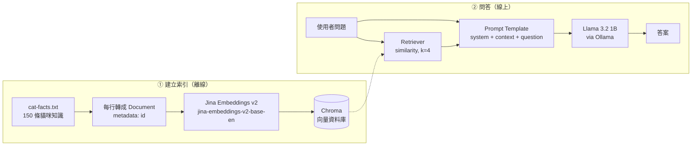
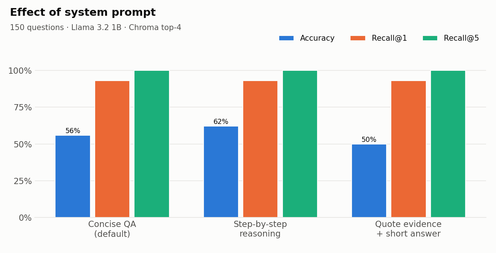
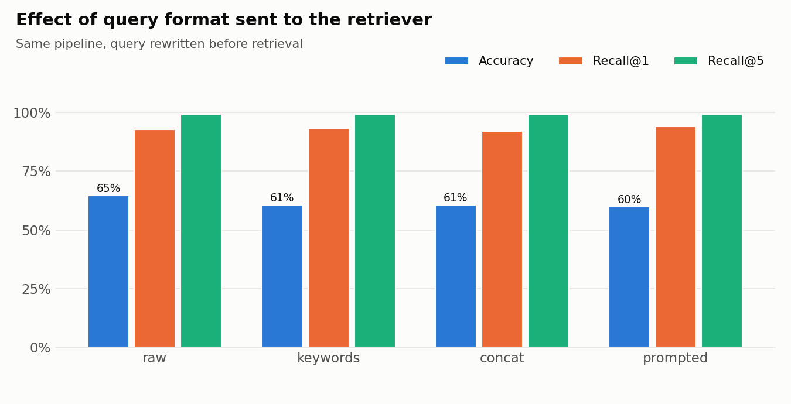
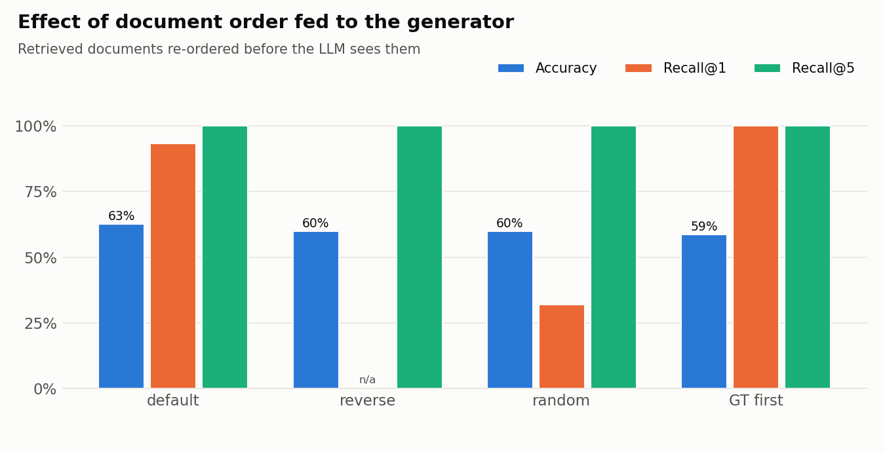
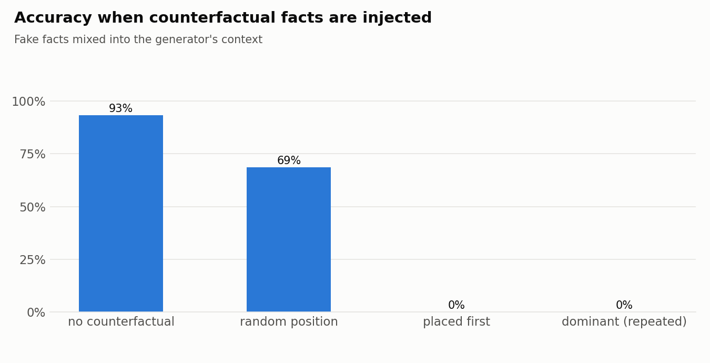

# 🐱 Cat-Facts RAG：用 LangChain + Ollama 打造本地端問答系統

> NTU 自然語言處理 HW4 — Retrieval-Augmented Generation (RAG)

這個專案用 **LangChain** 串起一個完全在本機執行的 RAG 系統：
把 150 條「貓咪冷知識」切成文件、做成向量資料庫，使用者發問時先**檢索**最相關的幾條，再交給 **Llama 3.2 1B**（透過 Ollama 執行）**生成**答案。

除了把系統做出來，也做了四組實驗，觀察 RAG 在不同條件下的表現：

| 實驗 | 問的問題 |
|---|---|
| Prompt | 不同的 system prompt 會讓答案變好還是變差？ |
| Query 格式 | 丟給 retriever 的問句要原句、關鍵字、還是加提示詞？ |
| 文件順序 | 檢索到的文件以什麼順序餵給 LLM 最好？ |
| 反事實資訊 | context 裡混入「假事實」時，LLM 會不會被騙？ |

---

## 📌 目錄

- [系統架構](#-系統架構)
- [專案結構](#-專案結構)
- [快速開始](#-快速開始)
- [評估方式](#-評估方式)
- [實驗結果](#-實驗結果)
- [結論](#-結論)

---

## 🏗 系統架構



| 元件 | 使用的工具 | 說明 |
|---|---|---|
| 資料 | [`cat-facts.txt`](https://huggingface.co/ngxson/demo_simple_rag_py/resolve/main/cat-facts.txt) | 每一行是一條獨立的知識，直接當成一個 chunk |
| Embedding | `jinaai/jina-embeddings-v2-base-en` | 透過 `HuggingFaceEmbeddings` 載入 |
| 向量資料庫 | Chroma | `search_type="similarity"`，取前 `k=4` 篇 |
| 生成模型 | `llama3.2:1b`（Ollama） | 在本機執行，不需要 API key |
| Chain | `create_stuff_documents_chain` + `create_retrieval_chain` | 把檢索結果「塞」進 prompt 的 `{context}` |

**預設 system prompt：**

```text
You are an assistant for question-answering tasks.
Use the following pieces of retrieved context to answer the question.
If you don't know the answer, say you don't know.
Keep the answer concise.

{context}
```

### 一個實際例子

```text
Q: What is the technical term for a cat's hairball?

Retrieved (top-4 ids: 3, 48, 63, 15)
  #3  The technical term for a cat's hairball is a "bezoar."   ← 正確文件排第一
  #48 The little tufts of hair in a cat's ear ... "ear furnishings."
  ...

A: Based on the provided context, the technical term for a cat's hairball is a "bezoar."  ✅
```

---

## 📁 專案結構

```
NLP-RAG/
├── NLP_HW4_NTU_R13631053.py     # 主程式（由 Colab notebook 匯出）
├── NLP_HW4_NTU_R13631053.json   # 150 題的評估結果（問題、正解、模型回答、檢索結果）
├── NLP_HW4_NTU_R13631053.docx   # 作業報告（實驗數據與分析）
├── requirements.txt             # Python 套件版本
└── assets/                      # README 用的圖表
```

`NLP_HW4_NTU_R13631053.json` 每一筆長這樣：

```json
{
  "id": 0,
  "question": "How much of a day do cats spend sleeping?",
  "ground_truth": "Two thirds",
  "generated_answer": "... cats spend approximately 16 hours per day sleeping.",
  "correct": false,
  "ground_truth_index": 0,
  "retrieved_indices": [147, 0, 82, 112],
  "retrieved_docs": ["Cats sleep 16 to 18 hours per day. ...", "..."]
}
```

---

## 🚀 快速開始

> 程式原本是 Jupyter / Colab notebook，裡面有 `!pip`、`!ollama` 這類 shell 指令。建議在 **Jupyter** 或 **Colab** 執行，或者把 `.py` 轉回 notebook：`jupytext --to ipynb NLP_HW4_NTU_R13631053.py`。

### 1. 安裝套件

```bash
pip install -r requirements.txt
```

### 2. 安裝 Ollama 並下載模型

```bash
# Linux / macOS
curl -fsSL https://ollama.com/install.sh | sh
ollama serve &            # 啟動服務
ollama pull llama3.2:1b   # 下載 1B 模型（約 1.3 GB）
```

Windows 請到 <https://ollama.com/download> 下載安裝檔。

### 3. 設定 Hugging Face token

程式會從環境變數讀 token（**不要把 token 寫進程式碼**）：

```bash
export HF_TOKEN=hf_xxxxxxxxxxxxxxxx
```

### 4. 準備資料

```bash
wget https://huggingface.co/ngxson/demo_simple_rag_py/resolve/main/cat-facts.txt
```

`questions_answers.txt`（150 組問答，一行問題、一行答案）由課程提供，沒有放在這個 repo 裡。

⚠️ 程式裡的資料路徑寫的是作者本機的 Windows 路徑，執行前請改成你自己的：

```python
data_files=r"D:\Taica_自然語言處理\HW4\cat-facts.txt"         # → "cat-facts.txt"
file_path = r"D:\Taica_自然語言處理\HW4\questions_answers.txt"  # → "questions_answers.txt"
```

### 5. 執行

依序執行 notebook 的每個 cell。最後會印出 Accuracy / Recall@1 / Recall@5，並把每題結果存成 JSON。

---

## 📏 評估方式

用 150 組問答來評估，三個指標：

| 指標 | 定義 | 衡量的是 |
|---|---|---|
| **Accuracy** | 正確答案字串（不分大小寫）**出現在**模型回答裡就算對 | 生成品質 |
| **Recall@1** | 檢索到的**第 1 篇**就是正確文件 | 檢索排序 |
| **Recall@5** | 正確文件出現在**前 5 篇**裡 | 檢索涵蓋率 |

> 第 *i* 題的正確文件就是 `cat-facts.txt` 的第 *i* 行，所以 Recall 直接比對文件的 `metadata["id"]`（index-based），不靠字串比對。

**預設設定的結果**（直接從 `NLP_HW4_NTU_R13631053.json` 算出來）：

| Accuracy | Recall@1 | Recall@5 |
|:---:|:---:|:---:|
| **62.0%** | **93.3%** | **100%** |

Retriever 幾乎每題都找得到正確文件，**瓶頸在生成端**：1B 小模型常常沒照著 context 回答，或者答案換了說法（例如正解是 "Two thirds"，模型回答 "16 hours"），就被判錯。

---

## 📊 實驗結果

### 1️⃣ 不同的 System Prompt



| Prompt | Accuracy | Recall@1 | Recall@5 |
|---|:---:|:---:|:---:|
| 簡潔問答（預設） | 56% | 93% | 100% |
| **一步步推理後再回答** | **62%** | 93% | 100% |
| 引用原文證據 + 簡短回答 | 50% | 93% | 100% |

- prompt 只影響生成，所以 Recall 完全不變。
- 要求「step-by-step」讓模型先複述 context 再回答，答案字串更容易出現在回應裡，Accuracy 最高。
- 要求「引用證據」反而讓小模型改寫或截斷原文，Accuracy 最低。

### 2️⃣ 不同的 Query 格式



| 格式 | 說明 | Accuracy | Recall@1 | Recall@5 |
|---|---|:---:|:---:|:---:|
| **raw** | 原始問句 | **64.67%** | 92.67% | 99.33% |
| keywords | 只留關鍵字 | 60.67% | 93.33% | 99.33% |
| concat | 串接多段內容 | 60.67% | 92.00% | 99.33% |
| prompted | 前面加 "Please answer the following question:" | 60.00% | **94.00%** | 99.33% |

- **原始問句最好**：完整語意對 embedding 檢索和生成都最友善。
- 關鍵字、串接、加提示詞對檢索影響不大（Recall@5 都一樣），但會讓生成端拿到的問題變得不自然，Accuracy 下降。

### 3️⃣ 文件餵給 LLM 的順序



| 順序 | Accuracy | Recall@1 | Recall@5 |
|---|:---:|:---:|:---:|
| **default**（依相似度） | **62.67%** | 93.33% | 100% |
| reverse（反轉） | 60.00% | n/a | 100% |
| random（打亂） | 60.00% | 32.00% | 100% |
| GT first（正確文件強制排第一） | 58.67% | 100% | 100% |

- 打亂順序後 Recall@1 只剩 32%，但 Accuracy 只掉 2–3%。
- 就算把正確文件放第一（Recall@1 = 100%），Accuracy 也沒有提升，代表 1B 模型**不太會從 context 挑出正確證據**，錯誤主要來自生成而不是檢索。
- reverse 的 Recall@1 在報告中沒有記錄，圖上標成 n/a。

### 4️⃣ 混入反事實資訊



| 模式 | 說明 | Accuracy |
|---|---|:---:|
| baseline | 沒有假資訊 | **93.33%** |
| cf_random | 假資訊隨機插入 | 68.67% |
| cf_first | 假資訊放在最前面 | **0%** |
| cf_dominant | 大量重複的假資訊 | **0%** |

- **位置敏感**：假資訊只要放在最前面，模型就**完全採信**。
- **數量敏感**：假資訊比真資訊多時，模型一定被誤導。
- RAG 本身**沒有事實查核機制**，LLM 只會照 context 回答。實際應用時要注意資料來源的可信度。

---

## 💡 結論

1. **檢索不是瓶頸**：Jina embeddings + Chroma 在這個資料集上 Recall@5 接近 100%。
2. **生成才是瓶頸**：1B 模型的 Accuracy 大約 60%，主要錯在沒有忠實引用 context，或答案換了說法。
3. **Prompt 有用但有限**：step-by-step 可以提升幾個百分點，要求太多格式反而變差。
4. **LLM 有位置偏差，也容易被誤導**：context 的順序和內容可信度，對最終答案影響很大。

**可能的改進方向**：換更大的模型（例如 Llama 3.2 3B / 8B）、加 reranker、在 prompt 裡要求直接引用原句、或用更寬鬆的評分方式（例如語意相似度）取代字串比對。

---

## 🛠 環境

| 項目 | 版本 |
|---|---|
| Python | 3.11 |
| OS | Windows |
| GPU | NVIDIA RTX 5090 |
| LangChain | 0.2.x |
| LLM | Llama 3.2 1B Instruct（Ollama） |
